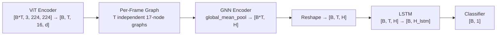
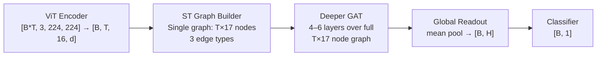

# Unified Spatio-Temporal Graph — Implementation Plan

## Problem Summary

The current pipeline has a **two-stage bottleneck**:



The `global_mean_pool` in Step C **collapses each frame's 17-node spatial structure into a single vector**. Only then does the LSTM see "time." The LSTM never knows *which patches* changed — just that *something* changed. This is the representational ceiling.

## Proposed Architecture

Replace the per-frame graph + LSTM with a **single unified spatio-temporal graph** per video:



**Key change**: Nodes are indexed `(t, i)` where `t` = frame index, `i` = patch/master index. Three edge types:

| Edge Type | Connects | Purpose |
|---|---|---|
| **Intra-frame spatial** | Patches within the same frame (4-connectivity + master) | Same as current — captures spatial adjacency |
| **Inter-frame homologous** | Same patch position across adjacent frames `(i,t)↔(i,t+1)` | Lets GNN directly compare how each patch changes over time |
| **Inter-frame master** | Master nodes across adjacent frames `(master_t)↔(master_t+1)` | Global frame-level temporal continuity |

> [!IMPORTANT]
> This **eliminates the LSTM entirely**. The GNN itself handles both spatial and temporal reasoning in a single message-passing phase. The LSTM's job (temporal modeling) is absorbed into the inter-frame edges of the unified graph.

---

## User Review Required

> [!WARNING]
> **Breaking change**: This creates a fundamentally different architecture. Old checkpoints (`best_e2e.pt`, `last_e2e.pt`) will **not** be loadable with the new model. Training must restart from scratch.

> [!IMPORTANT]
> **GNN depth increase**: The unified graph is larger (170 nodes for T=10 vs. 17 nodes). We increase GAT layers from 2 → 4 to give messages enough hops to propagate across time. This adds parameters but is still lightweight (~2x current GNN params). Memory is fine — 170 nodes is trivial for PyG.

> [!IMPORTANT]
> **Edge feature expansion**: We add a 3rd edge feature dimension — a **temporal distance** scalar — so the GNN knows whether an edge is spatial (0.0) or temporal (normalized frame gap). This changes `edge_dim` from 2 → 3.

---

## Proposed Changes

### Graph Construction — Core of the Change

#### [MODIFY] [graph_builder.py](file:///workspace/saumilya/GNN-Based-Deepfake-Detection-via-Spatio-Temporal-Relationship-Modeling/end_to_end_pipeline/graph_builder.py)

**Complete rewrite.** The current file builds `T` independent 17-node graphs. The new version builds **one** unified graph with `T × 17` nodes.

**New `build_st_graph()` function** (replaces `build_graph()` + `build_sequence_batch()`):

```python
def build_st_graph(
    z_patches: torch.Tensor,  # [T, 16, d]
    z_img: torch.Tensor,      # [T, d]
    T: int,
) -> Data:
```

**Node construction** (`T × 17` nodes):
- For each frame `t` in `[0, T)`:
  - 16 patch nodes: `x[t*17 + i] = [z_patches[t, i] || t_norm]` where `t_norm = t / (T-1)`
  - 1 master node: `x[t*17 + 16] = [z_img[t] || t_norm]`
- Total nodes: `T * 17` (e.g., 136 for T=8, 170 for T=10)

**Edge construction** — three types, each with 3D edge features `[manhattan_dist, cosine_sim, temporal_dist]`:

1. **Intra-frame spatial** (same as current, but offset per frame):
   - Patch 4-connectivity: `(t*17+i, t*17+j)` for adjacent patches
   - Master edges: `(t*17+16, t*17+i)` bidirectional
   - `temporal_dist = 0.0` (same frame)

2. **Inter-frame homologous** (NEW):
   - For each patch `i` and adjacent frames `t, t+1`: `(t*17+i, (t+1)*17+i)` bidirectional
   - For master nodes: `(t*17+16, (t+1)*17+16)` bidirectional
   - `temporal_dist = 1.0 / (T-1)` (normalized temporal gap)

3. Edge features: `[manhattan_distance, cosine_similarity, temporal_distance]`
   - Spatial edges: `[manhattan, cos_sim, 0.0]`
   - Temporal edges: `[0.0, cos_sim, t_gap]` (manhattan=0 for same-position temporal link)

**New `build_st_batch()` function** (replaces `build_sequence_batch()`):

```python
def build_st_batch(
    z_patches_bt: torch.Tensor,  # [B, T, 16, d]
    z_img_bt: torch.Tensor,      # [B, T, d]
    T: int,
) -> Batch:
    """Build B spatio-temporal graphs (one per video), batched into a single PyG Batch."""
```

This creates `B` graphs (one per video in the batch), each with `T*17` nodes, then batches them.

**`graph_metrics_from_batch()`** — updated to log:
- `graph/num_spatial_edges`, `graph/num_temporal_edges`
- `graph/spatial_cosine_sim_mean`, `graph/temporal_cosine_sim_mean`
- Same node norm stats as before

---

### GNN Encoder — Deeper + New Edge Dim

#### [MODIFY] [gnn_encoder.py](file:///workspace/saumilya/GNN-Based-Deepfake-Detection-via-Spatio-Temporal-Relationship-Modeling/end_to_end_pipeline/gnn_encoder.py)

Changes:
1. **`edge_dim`**: `2 → 3` (add temporal distance feature)
2. **Default `num_layers`**: `2 → 4` (more message-passing rounds for temporal propagation)
3. **Add residual connections**: For layers ≥ 2 where input/output dims match, add `x = x + x_prev` to prevent gradient degradation in deeper networks
4. **GCN edge encoder**: Update `nn.Linear(2, 1)` → `nn.Linear(3, 1)`

```diff
 class GNNEncoder(nn.Module):
     def __init__(
         self,
         in_channels: int,
         hidden_channels: int,
-        num_layers: int = 2,
+        num_layers: int = 4,
         gnn_type: str = "gat",
         gnn_dropout: float = 0.5,
         attn_dropout: float = 0.5,
     ) -> None:
         ...
         if gnn_type == "gat":
-            edge_dim = 2
+            edge_dim = 3
```

---

### Temporal Module — Removed

#### [DELETE] [temporal.py](file:///workspace/saumilya/GNN-Based-Deepfake-Detection-via-Spatio-Temporal-Relationship-Modeling/end_to_end_pipeline/temporal.py)

The LSTM `TemporalEncoder` is no longer needed. Temporal reasoning is absorbed into the unified GNN.

> [!NOTE]
> We won't actually delete the file (to preserve git history for comparison), but it will no longer be imported or used. We can optionally keep it for ablation experiments.

---

### Main Model — Rewired

#### [MODIFY] [model.py](file:///workspace/saumilya/GNN-Based-Deepfake-Detection-via-Spatio-Temporal-Relationship-Modeling/end_to_end_pipeline/model.py)

**Major changes to `EndToEndDeepfakeDetector`:**

1. **Remove LSTM-related code**: `TemporalEncoder`, `temporal_dropout`, `sequence_dropout`
2. **Replace `build_sequence_batch`** with `build_st_batch`
3. **Change forward flow**:

```python
# BEFORE:
# ViT → T per-frame graphs → GNN (pool each frame) → [B, T, H] → LSTM → [B, H_lstm] → classifier

# AFTER:
# ViT → 1 ST-graph per video → GNN (pool entire video) → [B, H] → classifier
```

4. **Classifier input dim**: Changes from `temporal_hidden (256)` → `gnn_hidden (128)` since we skip the LSTM
5. **Constructor signature**: Remove `temporal_hidden`, `temporal_dropout`, `sequence_dropout` params. Add `gnn_layers` default = 4.

**Updated forward pass:**

```python
def forward(self, frames, labels=None, return_metrics=True):
    # 1. ViT: [B, T, 3, H, W] → z_patches [B, T, 16, d], z_img [B, T, d]
    # 2. Build ST graph batch: B graphs, each T*17 nodes
    pyg_batch = build_st_batch(z_patches, z_img, t)
    # 3. GNN over full ST graph → global_mean_pool → [B, gnn_hidden]
    pooled = self.gnn(pyg_batch.x, pyg_batch.edge_index, pyg_batch.edge_attr, pyg_batch.batch)
    # 4. Classifier: [B, gnn_hidden] → [B, 1]
    preds = self.classifier_head(pooled)
```

**Updated `_embedding_separation()`**: Takes `[B, H]` directly (no temporal dim to mean over).

---

### Classifier — Unchanged

#### [KEEP] [classifier.py](file:///workspace/saumilya/GNN-Based-Deepfake-Detection-via-Spatio-Temporal-Relationship-Modeling/end_to_end_pipeline/classifier.py)

No changes needed. `input_dim` will just be `gnn_hidden` (128) instead of `temporal_hidden` (256).

---

### ViT Encoder — Unchanged

#### [KEEP] [vit_encoder.py](file:///workspace/saumilya/GNN-Based-Deepfake-Detection-via-Spatio-Temporal-Relationship-Modeling/end_to_end_pipeline/vit_encoder.py)

No changes. Same `[B, 16, d]` patch output and `[B, d]` CLS token output per frame.

---

### Config — Updated

#### [MODIFY] [config.yaml](file:///workspace/saumilya/GNN-Based-Deepfake-Detection-via-Spatio-Temporal-Relationship-Modeling/end_to_end_pipeline/config.yaml)

```diff
 model:
   vit_backbone: vit_small_patch16_224
   vit_pretrained: true
   gnn_type: gat
-  gnn_layers: 2
+  gnn_layers: 4
   gnn_hidden: 128
-  gnn_dropout: 0.5
-  attn_dropout: 0.5
-  temporal: lstm
-  temporal_hidden: 256
-  temporal_dropout: 0.2
-  classifier_dropout: 0.5
-  sequence_dropout: 0.2
+  gnn_dropout: 0.3
+  attn_dropout: 0.3
+  classifier_dropout: 0.3
```

> [!TIP]
> Dropout reduced from 0.5 → 0.3 as per the analysis in `plan.md` — the model was simultaneously over-regularized and architecturally underfit. With the new architecture providing more capacity, we start with moderate regularization.

---

### Training Script — Updated

#### [MODIFY] [train.py](file:///workspace/saumilya/GNN-Based-Deepfake-Detection-via-Spatio-Temporal-Relationship-Modeling/end_to_end_pipeline/train.py)

Changes:
1. **Model constructor call**: Remove `temporal_hidden`, `temporal_dropout`, `sequence_dropout` args
2. **Grad/weight logging**: Remove `model.temporal` references, replace with updated GNN references
3. **`snapshot_state` / `weight_update_ratio`**: Remove LSTM snapshots (`lstm_b`)
4. All other training logic (optimizer, scheduler, early stopping, W&B, focal loss) stays the same

---

### Dataset — Unchanged

#### [KEEP] [dataset.py](file:///workspace/saumilya/GNN-Based-Deepfake-Detection-via-Spatio-Temporal-Relationship-Modeling/end_to_end_pipeline/dataset.py)

No changes. Same `[T, 3, H, W]` output per video.

---

## Architecture Comparison

| Aspect | Current (Two-Stage) | Proposed (Unified ST-Graph) |
|---|---|---|
| Nodes per video | T × 17 (but T separate graphs) | T × 17 (one graph) |
| Temporal modeling | LSTM over collapsed graph embeddings | GNN message passing over inter-frame edges |
| Can detect patch-level temporal inconsistency | ❌ (collapsed before LSTM) | ✅ (direct inter-frame patch edges) |
| GNN layers | 2 | 4 |
| Edge features | 2D: [manhattan, cosine_sim] | 3D: [manhattan, cosine_sim, temporal_dist] |
| LSTM | 256-hidden LSTM | Eliminated |
| Total parameters | ~26M (ViT-S) + GNN + LSTM | ~26M (ViT-S) + deeper GNN (no LSTM) |
| Dropout stages | 5 (gnn, attn, temporal, classifier, sequence) | 3 (gnn, attn, classifier) |

---

## Open Questions

> [!IMPORTANT]
> **GNN hidden dim**: Should we increase `gnn_hidden` from 128 to 256 since we're removing the LSTM (which was 256)? The classifier input would be 256 instead of 128. This adds ~2x GNN params but may help capacity. My recommendation: keep 128 for now, increase only if underfitting persists.

> [!IMPORTANT]
> **Edge construction optimization**: The current graph builder uses Python loops which is slow. Should we vectorize edge construction with `torch.arange` + indexing? My recommendation: Yes, do it during implementation — it's critical for training speed with the larger graph.

---

## Verification Plan

### Automated Tests

1. **Smoke test** — Verify the model runs end-to-end with synthetic data:
   ```bash
   cd end_to_end_pipeline && python train.py --config config.yaml --smoke
   ```
   Should complete 3 smoke epochs without errors.

2. **Shape verification** — Check that:
   - ST graph has `T * 17` nodes per video
   - Edge index includes both spatial and temporal edges
   - Edge attr has 3 features per edge
   - GNN output is `[B, gnn_hidden]` (not `[B*T, gnn_hidden]`)
   - Final prediction is `[B, 1]`

3. **Gradient flow** — Verify gradients propagate through the full graph to the ViT:
   - Check `grads/vit_grad_norm > 0` after first backward pass
   - Check `grads/gnn_grad_norm > 0`

### Manual Verification

4. **Full Celeb-DF training run** — Train for 10-20 epochs and compare:
   - Training accuracy convergence speed vs. old architecture
   - Validation accuracy plateau
   - W&B metric dashboards (spatial vs. temporal edge cosine similarities)
