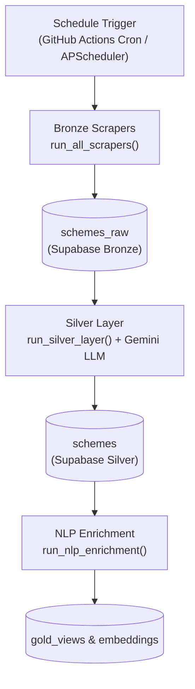

# Policy Radar India — Feature Implementation Plan

This implementation plan covers the roadmap, architecture, schema definitions, and code additions for the following three target features:
1. **Real-time Scheduling** (Option A: GitHub Actions & Option B: In-App APScheduler)
2. **Expand Portal Coverage** (BaseScraper pattern for new state & central portals)
3. **Founder Community Features** (Supabase schema, Next.js Community Forum & Advisor Directory)

---

## 1. Real-time Scheduling (⭐ Easiest — ~1–2 Hours)

### Overview
Automate daily scraping, silver ETL structuring (Gemini extraction), and NLP enrichment so policy and grant updates remain fresh without manual pipeline triggers.



### Option A: GitHub Actions Workflow (Recommended for Cloud Pipelines)
The repository already contains `.github/workflows/daily_pipeline.yml`.

#### 1. Setup Required Secrets
Ensure the following are added in **GitHub Repository Settings → Secrets and variables → Actions**:
* `SUPABASE_URL`: Supabase project URL.
* `SUPABASE_KEY`: Supabase service role key (for ETL insertion).
* `GEMINI_API_KEY`: Google Gemini API key for Silver extraction & NLP.

#### 2. Workflow Specification (`.github/workflows/daily_pipeline.yml`)
```yaml
name: Daily Pipeline Run

on:
  schedule:
    # 02:00 AM IST daily (20:30 UTC)
    - cron: '30 20 * * *'
  workflow_dispatch: # Allows manual trigger from GitHub UI

jobs:
  run-pipeline:
    runs-on: ubuntu-latest
    steps:
      - name: Checkout Repository
        uses: actions/checkout@v4

      - name: Set up Python
        uses: actions/setup-python@v5
        with:
          python-version: '3.12'

      - name: Install dependencies
        run: |
          python -m pip install --upgrade pip
          pip install -r requirements.txt

      - name: Install Playwright
        run: |
          playwright install-deps chromium
          playwright install chromium

      - name: Run Full Pipeline
        env:
          SUPABASE_URL: ${{ secrets.SUPABASE_URL }}
          SUPABASE_KEY: ${{ secrets.SUPABASE_KEY }}
          GEMINI_API_KEY: ${{ secrets.GEMINI_API_KEY }}
        run: |
          python -m pipeline.bronze_runner
          python -m pipeline.silver
          python -m pipeline.nlp_enrichment
```

---

### Option B: Python In-App Scheduler (`main.py`)

If running `main.py` continuously as a persistent service (Docker/VPS/VM):

#### 1. Install Dependency
```bash
pip install apscheduler
```

#### 2. Update `main.py`
Add the `AsyncIOScheduler` inside FastAPI's `lifespan` handler:
```python
from apscheduler.schedulers.asyncio import AsyncIOScheduler
from apscheduler.triggers.cron import CronTrigger
from contextlib import asynccontextmanager

scheduler = AsyncIOScheduler()

async def scheduled_pipeline_run():
    print("[CRON] Initiating automated nightly pipeline...")
    try:
        await run_all_scrapers()
        run_silver_layer()
        run_nlp_enrichment()
        print("[CRON] Nightly pipeline completed successfully.")
    except Exception as e:
        print(f"[CRON ERROR] Scheduled execution failed: {e}")

@asynccontextmanager
async def lifespan(app: FastAPI):
    # Runs everyday at 02:00 AM server time
    scheduler.add_job(
        scheduled_pipeline_run,
        CronTrigger(hour=2, minute=0),
        id="nightly_pipeline",
        replace_existing=True
    )
    scheduler.start()
    print("[SCHEDULER] Daily cron job started (02:00 AM).")
    yield
    scheduler.shutdown()

app = FastAPI(title="Policy Radar India API", lifespan=lifespan)
```

---

## 2. Expand Portal Coverage (⭐⭐ Easy to Moderate — ~30–45 Mins per Portal)

### Overview
Each scraper extracts raw announcements and scheme details, hashes the content to prevent duplicate records, and inserts into `schemes_raw` using `insert_into_bronze(source_url, raw_content)`. The existing Silver layer uses Gemini to automatically structure the data.

### Targeted Portals
1. **StartupTN** (`https://startuptn.in`) — Tamil Nadu State Startup Ecosystem
2. **Atal Innovation Mission (AIM)** (`https://aim.gov.in`) — NITI Aayog Schemes & Grants
3. **Startup Karnataka / Elevate** (`https://startup.karnataka.gov.in`)

---

### Step 1: Create Scraper File (`scrapers/startup_tn.py`)

```python
import httpx
from bs4 import BeautifulSoup
from scrapers.base_scraper import insert_into_bronze

PORTAL_URL = "https://startuptn.in"

async def scrape_startup_tn():
    """Scrapes scheme and grant announcements from StartupTN."""
    try:
        headers = {
            "User-Agent": "Mozilla/5.0 (Windows NT 10.0; Win64; x64) AppleWebKit/537.36 (KHTML, like Gecko) Chrome/120.0.0.0 Safari/537.36"
        }
        async with httpx.AsyncClient(verify=False, timeout=30.0, headers=headers) as client:
            response = await client.get(PORTAL_URL)
            if response.status_code != 200:
                print(f"[StartupTN] Failed with HTTP status: {response.status_code}")
                return

            soup = BeautifulSoup(response.text, "html.parser")
            title = soup.title.string.strip() if soup.title else "StartupTN Portal"

            # Parse relevant scheme and grant anchors
            schemes_found = []
            for link in soup.find_all("a", href=True):
                text = link.get_text(strip=True)
                if any(k in text.lower() for k in ["grant", "scheme", "fund", "seed", "tanseed", "subsidy"]):
                    href = link["href"]
                    full_url = href if href.startswith("http") else f"{PORTAL_URL}/{href.lstrip('/')}"
                    schemes_found.append({"title": text, "url": full_url})

            raw_data = {
                "portal_name": "StartupTN",
                "state": "Tamil Nadu",
                "page_title": title,
                "schemes_detected": schemes_found,
                "html_snippet": str(soup.body)[:15000]
            }

            insert_into_bronze(PORTAL_URL, raw_data)
            print(f"[StartupTN] Ingested {len(schemes_found)} candidate items into Bronze.")
    except Exception as e:
        print(f"[StartupTN Error] Scraper encountered an error: {e}")

if __name__ == "__main__":
    import asyncio
    asyncio.run(scrape_startup_tn())
```

---

### Step 2: Create Scraper File for NITI Aayog AIM (`scrapers/aim_niti.py`)

```python
import httpx
from bs4 import BeautifulSoup
from scrapers.base_scraper import insert_into_bronze

AIM_URL = "https://aim.gov.in"

async def scrape_aim_niti():
    """Scrapes programs and challenges from NITI Aayog Atal Innovation Mission."""
    try:
        headers = {"User-Agent": "Mozilla/5.0 (Windows NT 10.0; Win64; x64)"}
        async with httpx.AsyncClient(verify=False, timeout=30.0, headers=headers) as client:
            response = await client.get(AIM_URL)
            soup = BeautifulSoup(response.text, "html.parser")
            title = soup.title.string.strip() if soup.title else "Atal Innovation Mission"

            announcements = []
            for a in soup.find_all("a", href=True):
                text = a.get_text(strip=True)
                if any(word in text.lower() for word in ["aic", "cic", "scale", "fellowship", "grant", "challenge"]):
                    announcements.append({"title": text, "href": a["href"]})

            raw_data = {
                "portal_name": "Atal Innovation Mission (AIM)",
                "organization": "NITI Aayog",
                "page_title": title,
                "announcements": announcements,
                "html_snippet": str(soup.body)[:15000]
            }

            insert_into_bronze(AIM_URL, raw_data)
            print(f"[AIM NITI] Ingested {len(announcements)} announcements into Bronze.")
    except Exception as e:
        print(f"[AIM NITI Error] Scraper encountered an error: {e}")

if __name__ == "__main__":
    import asyncio
    asyncio.run(scrape_aim_niti())
```

---

### Step 3: Register in `pipeline/bronze_runner.py`
Add the new scrapers to the batch runner:
```python
from scrapers.startup_tn import scrape_startup_tn
from scrapers.aim_niti import scrape_aim_niti

async def run_all_scrapers():
    print("Starting all scrapers...")
    # ... existing scrapers
    await scrape_startup_tn()
    await scrape_aim_niti()
    print("Scraping completed.")
```

---

## 3. Founder Community Features (⭐⭐⭐ Moderate — ~1–2 Days)

### Overview
Provides an interactive discussion forum and a verified policy advisor directory for founders. Built with **Supabase PostgreSQL (tables + RLS)** and **Next.js (App Router, Tailwind CSS, Lucide Icons)**.

---

### Step 1: Database Migration (`migrations/005_community_schema.sql`)

Execute the following SQL in Supabase SQL Editor:

```sql
-- 1. Community Discussion Posts
CREATE TABLE community_posts (
    id UUID PRIMARY KEY DEFAULT gen_random_uuid(),
    author_id UUID REFERENCES auth.users(id) ON DELETE CASCADE,
    author_name TEXT NOT NULL,
    company_name TEXT DEFAULT 'Founder',
    category TEXT NOT NULL CHECK (category IN ('Grants', 'DPIIT Recognition', 'Compliance', 'Investor Pitch', 'General')),
    title TEXT NOT NULL,
    content TEXT NOT NULL,
    upvotes INT DEFAULT 0,
    created_at TIMESTAMPTZ DEFAULT NOW(),
    updated_at TIMESTAMPTZ DEFAULT NOW()
);

-- 2. Post Replies
CREATE TABLE community_replies (
    id UUID PRIMARY KEY DEFAULT gen_random_uuid(),
    post_id UUID REFERENCES community_posts(id) ON DELETE CASCADE,
    author_id UUID REFERENCES auth.users(id) ON DELETE CASCADE,
    author_name TEXT NOT NULL,
    content TEXT NOT NULL,
    created_at TIMESTAMPTZ DEFAULT NOW()
);

-- 3. Policy & Scheme Advisors
CREATE TABLE advisors (
    id UUID PRIMARY KEY DEFAULT gen_random_uuid(),
    name TEXT NOT NULL,
    role_title TEXT NOT NULL,
    organization TEXT NOT NULL,
    expertise TEXT[] NOT NULL,
    bio TEXT NOT NULL,
    linkedin_url TEXT,
    contact_email TEXT,
    is_verified BOOLEAN DEFAULT TRUE,
    created_at TIMESTAMPTZ DEFAULT NOW()
);

-- Enable Row Level Security (RLS)
ALTER TABLE community_posts ENABLE ROW LEVEL SECURITY;
ALTER TABLE community_replies ENABLE ROW LEVEL SECURITY;
ALTER TABLE advisors ENABLE ROW LEVEL SECURITY;

-- Post Policies
CREATE POLICY "Public read community_posts" 
    ON community_posts FOR SELECT USING (true);

CREATE POLICY "Authenticated users can create posts" 
    ON community_posts FOR INSERT WITH CHECK (auth.uid() = author_id);

CREATE POLICY "Authors can update own posts" 
    ON community_posts FOR UPDATE USING (auth.uid() = author_id);

CREATE POLICY "Authors can delete own posts" 
    ON community_posts FOR DELETE USING (auth.uid() = author_id);

-- Reply Policies
CREATE POLICY "Public read community_replies" 
    ON community_replies FOR SELECT USING (true);

CREATE POLICY "Authenticated users can reply" 
    ON community_replies FOR INSERT WITH CHECK (auth.uid() = author_id);

-- Advisor Directory Policies
CREATE POLICY "Public read advisors" 
    ON advisors FOR SELECT USING (true);

-- Seed Initial Advisors
INSERT INTO advisors (name, role_title, organization, expertise, bio, linkedin_url, contact_email)
VALUES
('Dr. Ramesh Sundaram', 'Senior Policy Consultant', 'Startup India Advisory Panel', ARRAY['DPIIT Section 80-IAC', 'Seed Fund Scheme', 'Tax Exemption'], 'Former advisor to DPIIT helping deep-tech startups navigate seed funding and angel tax exemption.', 'https://linkedin.com', 'advisor@policyradar.in'),
('Priya Venkat', 'Grant Specialist', 'BioNEST / BIRAC Mentor', ARRAY['BIRAC BIG', 'Biotech Grants', 'Clinical Trials Compliance'], 'Assists early-stage life sciences and medtech startups in writing winning BIRAC grant proposals.', 'https://linkedin.com', 'priya@policyradar.in'),
('Anand Kulkarni', 'Legal & Regulatory Lead', 'Fintech Regulatory Sandbox', ARRAY['RBI Sandbox', 'FDI Regulations', 'ESOP Compliance'], 'Specializes in DPIIT compliances, cross-border payments, and fintech compliance sandbox applications.', 'https://linkedin.com', 'anand@policyradar.in');
```

---

### Step 2: Next.js Frontend Page (`frontend/src/app/community/page.tsx`)

Create the community page at `frontend/src/app/community/page.tsx`:

```tsx
"use client";

import React, { useState, useEffect } from "react";
import { createClient } from "@/lib/supabase/client";
import { MessageSquare, Users, ThumbsUp, Send, CheckCircle2, Linkedin, Mail } from "lucide-react";

interface Post {
  id: string;
  author_name: string;
  company_name: string;
  category: string;
  title: string;
  content: string;
  upvotes: number;
  created_at: string;
}

interface Advisor {
  id: string;
  name: string;
  role_title: string;
  organization: string;
  expertise: string[];
  bio: string;
  linkedin_url?: string;
  contact_email?: string;
}

export default function CommunityPage() {
  const [activeTab, setActiveTab] = useState<"forum" | "advisors">("forum");
  const [posts, setPosts] = useState<Post[]>([]);
  const [advisors, setAdvisors] = useState<Advisor[]>([]);
  const [newTitle, setNewTitle] = useState("");
  const [newContent, setNewContent] = useState("");
  const [newCategory, setNewCategory] = useState("Grants");
  const [isSubmitting, setIsSubmitting] = useState(false);

  const supabase = createClient();

  useEffect(() => {
    fetchPosts();
    fetchAdvisors();
  }, []);

  const fetchPosts = async () => {
    const { data } = await supabase
      .from("community_posts")
      .select("*")
      .order("created_at", { ascending: false });
    if (data) setPosts(data);
  };

  const fetchAdvisors = async () => {
    const { data } = await supabase.from("advisors").select("*");
    if (data) setAdvisors(data);
  };

  const handleCreatePost = async (e: React.FormEvent) => {
    e.preventDefault();
    if (!newTitle.trim() || !newContent.trim()) return;

    setIsSubmitting(true);
    const { data: { user } } = await supabase.auth.getUser();

    const { error } = await supabase.from("community_posts").insert({
      author_id: user?.id,
      author_name: user?.user_metadata?.full_name || user?.email?.split("@")[0] || "Founder",
      company_name: user?.user_metadata?.company_name || "Startup India",
      category: newCategory,
      title: newTitle,
      content: newContent,
    });

    setIsSubmitting(false);
    if (!error) {
      setNewTitle("");
      setNewContent("");
      fetchPosts();
    }
  };

  const handleUpvote = async (postId: string, currentUpvotes: number) => {
    const { error } = await supabase
      .from("community_posts")
      .update({ upvotes: currentUpvotes + 1 })
      .eq("id", postId);

    if (!error) {
      setPosts((prev) =>
        prev.map((p) => (p.id === postId ? { ...p, upvotes: p.upvotes + 1 } : p))
      );
    }
  };

  return (
    <div className="max-w-6xl mx-auto px-4 py-8">
      {/* Header */}
      <div className="mb-8">
        <h1 className="text-3xl font-bold tracking-tight text-slate-900">Founder Community & Mentors</h1>
        <p className="text-slate-500 mt-1">Discuss scheme approvals, grant application advice, and connect with verified policy advisors.</p>
      </div>

      {/* Tabs */}
      <div className="flex border-b border-slate-200 mb-6 gap-6">
        <button
          onClick={() => setActiveTab("forum")}
          className={`flex items-center gap-2 pb-3 text-sm font-semibold border-b-2 transition-colors ${
            activeTab === "forum"
              ? "border-blue-600 text-blue-600"
              : "border-transparent text-slate-500 hover:text-slate-800"
          }`}
        >
          <MessageSquare className="w-4 h-4" /> Discussion Feed
        </button>
        <button
          onClick={() => setActiveTab("advisors")}
          className={`flex items-center gap-2 pb-3 text-sm font-semibold border-b-2 transition-colors ${
            activeTab === "advisors"
              ? "border-blue-600 text-blue-600"
              : "border-transparent text-slate-500 hover:text-slate-800"
          }`}
        >
          <Users className="w-4 h-4" /> Policy Advisors ({advisors.length})
        </button>
      </div>

      {/* Discussion Forum Tab */}
      {activeTab === "forum" ? (
        <div className="grid grid-cols-1 lg:grid-cols-3 gap-8">
          <div className="lg:col-span-2 space-y-4">
            {posts.length === 0 ? (
              <div className="p-8 text-center bg-white border border-slate-200 rounded-xl text-slate-500">
                No discussion threads yet. Be the first founder to post!
              </div>
            ) : (
              posts.map((post) => (
                <div key={post.id} className="p-5 bg-white border border-slate-200 rounded-xl shadow-xs">
                  <div className="flex items-center justify-between mb-2">
                    <span className="text-xs font-semibold px-2.5 py-0.5 bg-blue-50 text-blue-700 rounded-full">
                      {post.category}
                    </span>
                    <span className="text-xs text-slate-400">
                      {new Date(post.created_at).toLocaleDateString()}
                    </span>
                  </div>
                  <h3 className="text-lg font-semibold text-slate-900">{post.title}</h3>
                  <p className="text-sm text-slate-600 mt-2 whitespace-pre-line">{post.content}</p>
                  <div className="mt-4 pt-3 border-t border-slate-100 flex items-center justify-between text-xs text-slate-500">
                    <span>By {post.author_name} • {post.company_name}</span>
                    <button
                      onClick={() => handleUpvote(post.id, post.upvotes || 0)}
                      className="flex items-center gap-1.5 hover:text-blue-600 transition-colors cursor-pointer"
                    >
                      <ThumbsUp className="w-3.5 h-3.5" /> {post.upvotes || 0}
                    </button>
                  </div>
                </div>
              ))
            )}
          </div>

          {/* New Post Form */}
          <div className="p-5 bg-white border border-slate-200 rounded-xl shadow-xs h-fit sticky top-6">
            <h2 className="font-semibold text-slate-900 mb-3">Ask or Share an Update</h2>
            <form onSubmit={handleCreatePost} className="space-y-3">
              <div>
                <label className="block text-xs font-medium text-slate-700 mb-1">Topic Category</label>
                <select
                  value={newCategory}
                  onChange={(e) => setNewCategory(e.target.value)}
                  className="w-full text-sm border border-slate-200 rounded-lg p-2.5 bg-white focus:outline-blue-500"
                >
                  <option value="Grants">Grants & Subsidies</option>
                  <option value="DPIIT Recognition">DPIIT Recognition</option>
                  <option value="Compliance">Compliance & Tax Exemption</option>
                  <option value="Investor Pitch">Investor Pitch</option>
                  <option value="General">General Discussion</option>
                </select>
              </div>

              <div>
                <label className="block text-xs font-medium text-slate-700 mb-1">Title</label>
                <input
                  type="text"
                  placeholder="e.g. Has anyone received the SISFS seed grant approval in Tamil Nadu?"
                  value={newTitle}
                  onChange={(e) => setNewTitle(e.target.value)}
                  className="w-full text-sm border border-slate-200 rounded-lg p-2.5 focus:outline-blue-500"
                />
              </div>

              <div>
                <label className="block text-xs font-medium text-slate-700 mb-1">Details</label>
                <textarea
                  placeholder="Share details, questions, or timeline experiences..."
                  rows={4}
                  value={newContent}
                  onChange={(e) => setNewContent(e.target.value)}
                  className="w-full text-sm border border-slate-200 rounded-lg p-2.5 focus:outline-blue-500"
                />
              </div>

              <button
                type="submit"
                disabled={isSubmitting}
                className="w-full bg-blue-600 text-white font-medium text-sm py-2 rounded-lg hover:bg-blue-700 transition-colors flex items-center justify-center gap-2 cursor-pointer disabled:opacity-50"
              >
                <Send className="w-4 h-4" /> {isSubmitting ? "Posting..." : "Post to Community"}
              </button>
            </form>
          </div>
        </div>
      ) : (
        /* Advisor Directory Tab */
        <div className="grid grid-cols-1 md:grid-cols-2 lg:grid-cols-3 gap-6">
          {advisors.map((advisor) => (
            <div key={advisor.id} className="p-5 bg-white border border-slate-200 rounded-xl shadow-xs flex flex-col justify-between">
              <div>
                <div className="flex items-center justify-between mb-1">
                  <h3 className="font-bold text-slate-900">{advisor.name}</h3>
                  <CheckCircle2 className="w-4 h-4 text-emerald-500" />
                </div>
                <p className="text-xs text-blue-600 font-medium">{advisor.role_title} • {advisor.organization}</p>
                <p className="text-xs text-slate-600 mt-3">{advisor.bio}</p>
                <div className="flex flex-wrap gap-1 mt-3">
                  {advisor.expertise.map((tag, idx) => (
                    <span key={idx} className="text-[11px] bg-slate-100 text-slate-700 px-2 py-0.5 rounded">
                      {tag}
                    </span>
                  ))}
                </div>
              </div>
              <div className="flex items-center gap-3 mt-5 pt-3 border-t border-slate-100">
                {advisor.linkedin_url && (
                  <a href={advisor.linkedin_url} target="_blank" rel="noreferrer" className="text-slate-400 hover:text-blue-600 transition-colors">
                    <Linkedin className="w-4 h-4" />
                  </a>
                )}
                {advisor.contact_email && (
                  <a href={`mailto:${advisor.contact_email}`} className="text-slate-400 hover:text-blue-600 transition-colors">
                    <Mail className="w-4 h-4" />
                  </a>
                )}
              </div>
            </div>
          ))}
        </div>
      )}
    </div>
  );
}
```

---

## 4. Verification & Testing Checklist

| Step | Action | Command / Test | Expected Result |
| :--- | :--- | :--- | :--- |
| **1.1** | Test In-App APScheduler | `python -c "from main import app; print('FastAPI loaded successfully')"` | App initializes with lifespan background scheduler |
| **1.2** | Test GitHub Actions | Trigger via `gh workflow run daily_pipeline.yml` or manual dispatch | Runner completes all steps and inserts bronze/silver records |
| **2.1** | Test StartupTN Scraper | `python -m scrapers.startup_tn` | Inserts raw items into `schemes_raw` with SHA-256 hash |
| **2.2** | Test AIM NITI Scraper | `python -m scrapers.aim_niti` | Inserts raw announcements into `schemes_raw` |
| **2.3** | Test Silver Transformation | `curl -X POST http://localhost:8000/pipeline/run-silver` | Gemini structures the new raw records into `schemes` table |
| **3.1** | Test Community Migration | Check Supabase dashboard table editor | `community_posts`, `community_replies`, and `advisors` created with RLS |
| **3.2** | Test Community Frontend | Visit `http://localhost:3000/community` | Submit post, see thread in feed, view advisor cards |
